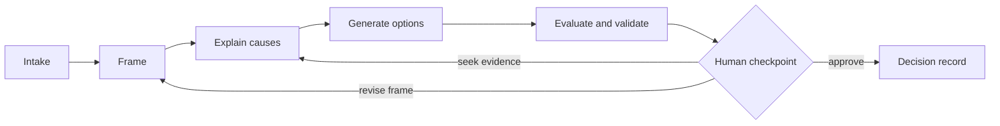

# FrameShift

FrameShift is an open-source, interactive reasoning system for finding the right problem before optimizing a solution.

Engineering requests often arrive as solutions in disguise: “select a 5 kW DC/DC,” “change the motor,” or “add a battery.” FrameShift reframes these requests; makes assumptions and evidence explicit; builds inspectable causal models; explores alternatives; and records why a decision was made.

> **Status:** specification-first, pre-alpha. The product specification, contracts, and implementation backlog live in the [issue tracker](https://github.com/tinix84/frameshift/issues). This repository holds the durable decisions, the domain language, and the machine-checkable contracts. It does not yet contain a production application.

## Product promise

FrameShift helps a person or team:

1. distinguish an observation, need, requirement, constraint, assumption, and proposed solution;
2. reframe the problem at useful abstraction levels and system boundaries;
3. build causal hypotheses with evidence, confidence, and counter-evidence;
4. generate structurally different options rather than variants of the first idea;
5. compare options against explicit outcomes, constraints, risks, and uncertainty;
6. pause at consequential checkpoints for human judgment; and
7. resume the same reasoning trace across different LLMs and agent runtimes.

## Core loop

The ranked abstraction levels are component, subsystem, system, product, and
business. See [ADR-0016](docs/adr/0016-independent-frame-axes.md) for the frame-axis decision.



## Principles

1. **Frame before solving.** Identify whether the input is a problem, function, requirement, constraint, assumption, or proposed solution.
2. **Move across boundaries.** Ask “why” to move toward outcomes and “how” to move toward mechanisms.
3. **Separate fact from interpretation.** Claims, evidence, assumptions, and uncertainty are first-class.
4. **Prefer plural hypotheses and options.** Avoid single-chain root-cause theater and first-solution anchoring.
5. **Keep the human accountable.** The tool structures judgment; it does not launder model output into authority.
6. **Make reasoning portable.** A session survives a change of model, provider, interface, or agent runtime.
7. **Earn complexity.** The first useful product is a narrow vertical slice, not a universal ontology.
8. **The person sets the pace.** The model drafts fast. The person decides in their own words, at the pace of their own understanding ([ADR-0035](docs/adr/0035-the-person-authors-the-deciding-words.md), [ADR-0036](docs/adr/0036-the-person-attempts-before-the-reasoner-proposes.md)).

## Non-goals

- Autonomous approval or execution of consequential engineering decisions.
- Replacing simulation, domain analysis, experiments, certification, or expert review.
- Capturing or exposing private model chain-of-thought — never requested, never stored.
- Guaranteeing root cause, optimality, correctness, or completeness.
- Building a general-purpose project manager or note-taking system.

## Where things are written

Each kind of statement has exactly one home. Nothing is stated twice.

| Statement | Home |
|---|---|
| What a word means | [`CONTEXT.md`](CONTEXT.md) |
| Why we chose X over Y | [`docs/adr`](docs/adr), indexed in [`CLAUDE.md`](CLAUDE.md) |
| What to build, and the contracts it must meet | [GitHub issues](https://github.com/tinix84/frameshift/issues) |
| Status of anything | GitHub issues and milestones `M0`–`M4` |
| The machine-checkable shape of state | [`schemas`](schemas) |
| How a runtime is bootstrapped | [`adapters`](adapters) |
| Versioned prompt text | [`prompts`](prompts) |
| Portable evaluation harness and fixtures | [`evals`](evals) |

Start with the specification issues: [#23 product requirements](https://github.com/tinix84/frameshift/issues/23), [#19 runtime portability](https://github.com/tinix84/frameshift/issues/19), [#20 prompt contracts](https://github.com/tinix84/frameshift/issues/20), [#21 tool capability abstraction](https://github.com/tinix84/frameshift/issues/21), [#22 deterministic checkpoints](https://github.com/tinix84/frameshift/issues/22), and [#24 API and event contracts](https://github.com/tinix84/frameshift/issues/24).

## Quick validation

Requires Python 3.11+ and no third-party packages.

```sh
python scripts/validate_repo.py
python evals/run.py
```

The evaluator includes the worked [exemplar corpus](corpus/README.md), which
is a useful starting point for understanding the expected reasoning behaviour.

The first implementation milestone is a vertical slice that accepts an intake, produces a framing ladder, asks for human approval, and writes a portable checkpoint — milestone [`M1`](https://github.com/tinix84/frameshift/milestone/2).

## Work in tandem with a reasoner

FrameShift calls no model ([ADR-0009](docs/adr/0009-mcp-server-runtime-boundary.md)). A reasoner, such as Claude Code, connects to FrameShift as an MCP client. The reasoner proposes and challenges. You judge in the manual GUI. Both processes write the same event log for each session, and a stale write from either one is refused ([#286](https://github.com/tinix84/frameshift/issues/286)).

The reasoner server has nine tools. Three read: list the sessions, read one session with its grounding, and read its event history. Six write: add a statement, propose a frame, record a ladder rung, offer a node or an edge, and raise a challenge. It has no tool that decides. Only the GUI opens a session, records your own words, activates or withdraws a frame, answers or concedes a challenge, parks or reopens a line, and approves a gate.

Try it in five steps. Run each command from the repository root.

1. Start the GUI. It opens `http://127.0.0.1:8765/` and stores sessions in `.frameshift/sessions`. Open a session from your request on the page.

   ```sh
   python -m frameshift.bootstrap gui
   ```

2. Register the reasoner server with Claude Code. The server reads the same store. `--actor` is the id that its challenges and causal edges record.

   ```sh
   claude mcp add frameshift -- python -m frameshift.bootstrap reasoner --store .frameshift/sessions --actor reasoner_local
   ```

   The project-scoped equivalent in `.mcp.json` is:

   ```json
   {
     "mcpServers": {
       "frameshift": {
         "command": "python",
         "args": ["-m", "frameshift.bootstrap", "reasoner", "--store", ".frameshift/sessions", "--actor", "reasoner_local"]
       }
     }
   }
   ```

3. Start Claude Code in the repository root. Make sure that `claude mcp list` shows `frameshift` as connected.
4. Ask Claude to read your session and add the statements it infers in intake. Seal intake in the GUI. Then ask for two to five candidate frames that differ in outcome, level or boundary. Activate one and seal frame selection in the GUI.
5. In the causal step, ask Claude to add hypotheses, evidence and the edges between them, and to challenge the weakest node. The GUI draws each change within about three seconds. Answer or concede each challenge, and park a dead-end line, in the GUI.

The GUI holds a redraw while you type in a form. A notice then offers the latest revision. A save from that form is refused as stale, so copy your entry first.

**Limit.** The GUI's approvals rest on your attestation that no agent runs under your account while it is open ([ADR-0022](docs/adr/0022-manual-gui-boundary.md)). Claude Code in the same account breaks that attestation. The reasoner server exposes no approval, but Claude Code can reach the loopback page through its other tools. An approval made during a tandem run still records the local manual profile, so the log does not show that an agent was running. Do not count such an approval as evidence of a trusted human confirmation. Whether a tandem run gets its own approval profile is not decided yet. How to install and start the server and the GUI for other users is open in [#189](https://github.com/tinix84/frameshift/issues/189).

## Runtime portability

The canonical state is JSON, never provider-specific chat history. Every engine consumes and emits versioned contracts, tools are discovered through a capability manifest, and checkpoints include normalized outputs plus hashes.

## Contributing and governance

Read [CONTRIBUTING.md](CONTRIBUTING.md), [SECURITY.md](SECURITY.md), and the [Code of Conduct](CODE_OF_CONDUCT.md). Architectural changes require an ADR. Security reports must not be filed as public issues.

## License

Licensed under the [Apache License 2.0](LICENSE).
